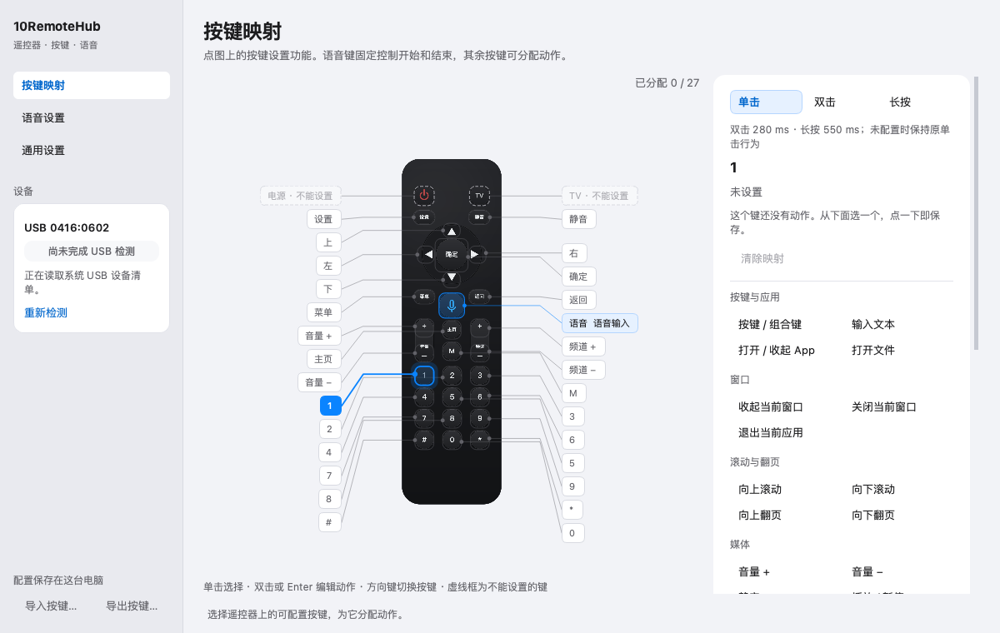
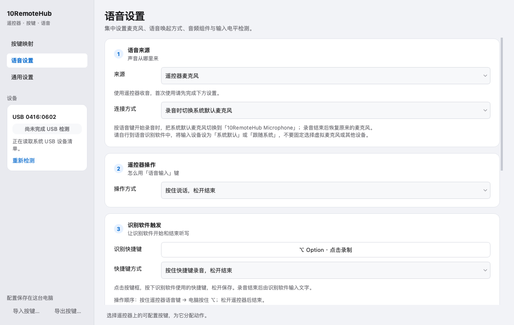

# 10RemoteHub

把 0416:0602 USB 接收器配套的 2.4G 语音遥控器变成 macOS / Windows 的按键面板与语音入口。

- 27 个普通键可设置单击、双击、长按动作；语音键固定用于开始/结束语音。
- 支持快捷键、应用切换、打开应用或文件、输入文本、窗口与媒体控制。
- 遥控器音频在本机送入虚拟麦克风，由用户选择的外部输入法或识别软件处理。
- 默认诊断日志不记录按键内容、预设文本、录音或完整个人路径。

当前源码版本为 0.1.0，依赖基线为 Python 3.12 / PySide6 6.12.0。macOS 要求 14 或更新；Windows x64 已实机验证。Linux 实现未纳入本次源码快照和发布范围。

本目录是最新版本的独立源码快照，初始提交不包含开发仓库的旧历史。发布文件分别提供 macOS arm64、Windows x64 安装包及对应第三方源码。安装前请阅读平台说明并核对 SHA-256。

## 界面预览

按键映射：选择遥控器上的按键，再设置单击、双击或长按动作。



语音设置：选择声音来源、遥控器操作方式和识别软件快捷键。



截图展示 macOS 界面与示例配置；左侧未完成 USB 检测，不代表设备已连接或通过实机验收。Windows 的驱动与虚拟麦克风设置有所不同。

## 安装使用

从 [GitHub Releases](https://github.com/yizhixiaoheigou/10RemoteHub/releases) 下载对应平台的发布包，并核对同页的 `SHA256SUMS`。具体安装、授权和卸载步骤见下方平台说明。

- **macOS**：[安装、授权、语音配置、更新与卸载](desktop/INSTALL-macOS.md)。主程序放入「应用程序」，安装统一采集组件并授权辅助功能；使用遥控器麦克风时再安装虚拟麦克风。
- **Windows**：[解压运行、Zadig 接口绑定、语音配置与卸载](desktop/INSTALL-Windows.md)。完整接入遥控器需配置 WinUSB；使用遥控器麦克风时再安装 VB-CABLE。

开发者可按下方步骤安装源码依赖并运行自动验证。真实硬件接入仍需要平台组件和权限，安装 Python 依赖不会自动完成这些步骤。

## 从源码验证

macOS 上使用项目隔离环境：

```sh
cd desktop
python3.12 -m venv .venv
.venv/bin/python -m pip install --upgrade 'pip>=26.2'
.venv/bin/python -m pip install --require-hashes -r requirements-macos-arm64.lock
.venv/bin/python -m pip install --no-deps --no-build-isolation -e .
.venv/bin/python scripts/verify.py --output ../artifacts/verification.json
```

Intel Mac 使用 `requirements-macos-x86_64.lock`。Windows PowerShell 使用以下命令：

```powershell
cd desktop
py -3.12 -m venv .venv
.\.venv\Scripts\python.exe -m pip install --upgrade "pip>=26.2"
.\.venv\Scripts\python.exe -m pip install --require-hashes -r requirements-windows-x64.lock
.\.venv\Scripts\python.exe -m pip install --no-deps --no-build-isolation -e .
.\.venv\Scripts\python.exe scripts\verify.py --output ..\artifacts\verification.json
```

离屏测试使用模拟设备，不安装组件或修改系统音频设置。正式构建的签名身份、许可材料与构建流程见 [RELEASE.md](desktop/RELEASE.md)。

本轮 macOS 自动化验证为 **498 passed / 3 skipped**，Windows 为 **442 passed / 57 skipped**，两端离屏启动通过；跳过项主要是另一平台专属验证。Mac 新包已通过签名、许可和解包启动检查；Windows 新包已在独立目录验证解压安装、旧版升级、回滚、卸载及配置保留。Mac 修复后的安装、卸载、旧版恢复与最终安装也已通过，用户配置保持不变。实体按键与语音沿用此前实机验证结论；维护者决定本轮不再重复实测，不将本轮自动化结果表述为新包的实体复验。由于没有 Intel Mac，本轮不做 Intel 真机测试，不承诺其硬件兼容性。

## 使用与开发资料

- [macOS 安装与权限](desktop/INSTALL-macOS.md)
- [Windows 安装与第三方组件](desktop/INSTALL-Windows.md)
- [常见问题](desktop/TROUBLESHOOTING.md)
- [按键表](desktop/KEYMAP.md)、[架构](desktop/ARCHITECTURE.md)、[系统动作](desktop/docs/PLATFORM-ACTIONS.md)
- [参与开发](CONTRIBUTING.md)、[安全报告](SECURITY.md)

macOS 的设备采集组件与可选虚拟麦克风需要用户通过标准安装器安装。Windows 的 Zadig 和 VB-CABLE 由用户向原提供者获取，本项目不附带这些安装程序。安装虚拟麦克风可能中断正在进行的通话或录音，详见安装说明。

## 许可

项目原创代码采用 [MIT](LICENSE)。内置 Python 音频解码器沿用 LGPL-2.1-or-later，Apple 示例及其他第三方代码保留各自许可；MIT 不覆盖这些组件。详见 [第三方声明](desktop/THIRD_PARTY_NOTICES.txt)、[内置解码器来源](desktop/remotehub/codec/NOTICE.md) 和 [对应源码/修改版说明](desktop/licenses/SOURCE.md)。

当前遥控器图为程序生成的示意图；源码快照不含旧照片、个人诊断日志、配置或闭源解码器实验。`SOURCE-INVENTORY.json` 记录该快照各文件的 SHA-256。
